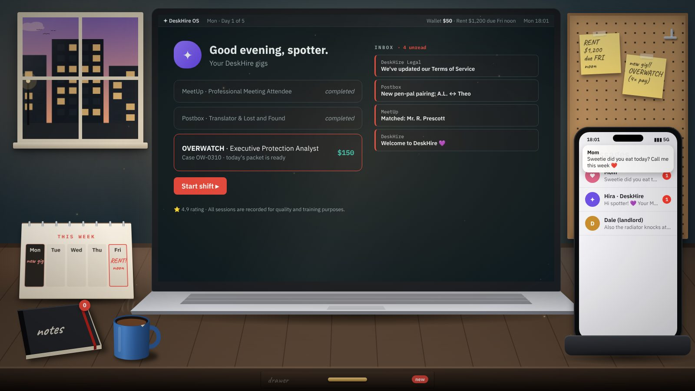
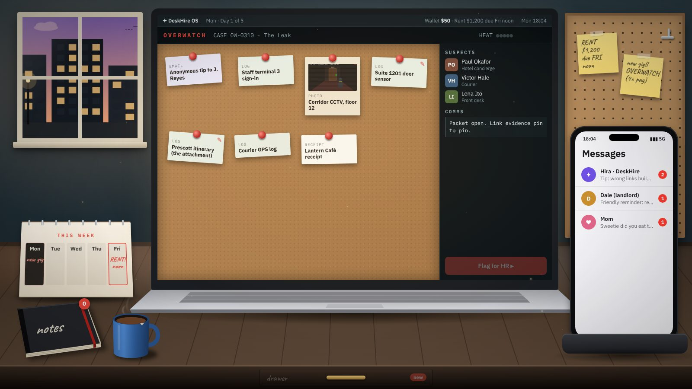
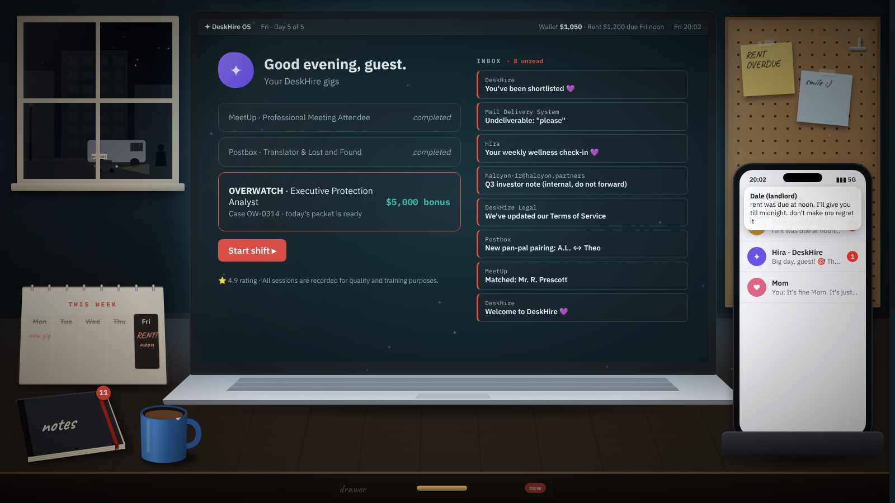

# Out of Office

**A work-from-home thriller.** Five nights as a remote *Spotter*. Collect the evidence. Clear the innocent. Call it in. Make rent by Friday.

### [▶ Play in your browser](https://z4b333.github.io/out-of-office/)



You took a gig through **DeskHire**, the friendliest staffing app around. The new one, **OVERWATCH**, pays four times the usual rate. Every night a packet of evidence lands on your laptop. Pin it to the corkboard, string the facts together, rule out the suspects who couldn't have done it, and confirm the target.

Rent is $1,200, due Friday at noon. Your mom keeps texting. Your landlord keeps texting. Someone you don't know has started texting too.

Write down anything that doesn't add up. You'll need it.

## How to play

| | |
|---|---|
| **Laptop** | DeskHire home, your inbox, and the OVERWATCH app where each night's case opens. |
| **Corkboard** | Drag evidence cards around. Click one card's pin, then another card's, to connect them with red string. The right connections reveal what really happened and rule suspects out. Wrong ones raise your *heat*, and heat costs pay. |
| **Files** | Open a card to read it. If a detail feels *off*, click it to write it in your notebook. |
| **Coffee mug** | Three cups a night. Spend one to unredact a blacked-out document, or for 30 more seconds on the clock. |
| **Notebook** | Every clue you've written down. On Friday it's all you have. |
| **Phone** | Texts arrive through the night. Read them. |
| **Drawer** | The last tenant left some things behind. Something new turns up each day. |
| **Scope** | When one suspect is left, you see them through the scope: **Go**, **No-go**, or, if you've worked out who they really are, **Warn them**. |

Every choice costs someone something. There is no clean ending.

<table>
  <tr>
    <td></td>
    <td></td>
  </tr>
  <tr>
    <td align="center"><sub>The OVERWATCH corkboard</sub></td>
    <td align="center"><sub>Friday night. The room gets darker as the week goes on.</sub></td>
  </tr>
</table>

Best played in a desktop browser. Progress saves automatically in your browser.

## Run it locally

No build step and no dependencies: it's plain HTML, CSS and JavaScript modules. Browsers block modules on `file://`, so serve the folder over HTTP:

```sh
git clone https://github.com/z4b333/out-of-office.git
cd out-of-office
python3 -m http.server 8000
# open http://localhost:8000
```

Any static server works (`npx serve`, VS Code Live Server, and so on).

**Testing shortcut:** on the title screen, open *Testing: jump to a day* to start on any night with the earlier days marked as played. Each board then gets an ⚡ Auto-solve button.

## Project layout

```
index.html              The desk: one fixed 1600×900 stage, scaled to fit the window
css/
  theme.css             Palette tokens; the room darkens from Monday dusk to Friday night
  desk.css              Desk objects, phone, overlays, ambient motion
  spotter.css           The OVERWATCH app: corkboard, cards, scope
js/
  main.js               Boot, title screen, save/continue
  core/                 Game state, day cycle, event bus, day-jump for testing
  desk/                 Window, notes, calendar, mug, notebook, phone, drawer
  apps/                 Laptop home, OVERWATCH (board, scope, deduction), Friday finale
  ui/                   SVG art (window view, evidence photos), prologue, endings
  data/days/            Each night's case, texts, notes and lore
docs/
  STORY.md              The story bible (full spoilers)
```

The art is drawn in code: the window view and evidence photos are inline SVG built in `js/ui/art.js`, and the desk is SVG and CSS. The fonts are [IBM Plex](https://github.com/IBM/plex) and [Caveat](https://fonts.google.com/specimen/Caveat), loaded from Google Fonts.

## Accessibility

Most ambient motion (drifting clouds, dust, flickering lights, swaying notes) turns off if your system has *Reduce motion* enabled.

## Spoilers

[`docs/STORY.md`](docs/STORY.md) explains everything: who is really behind DeskHire, every clue, and every ending. Play first.
